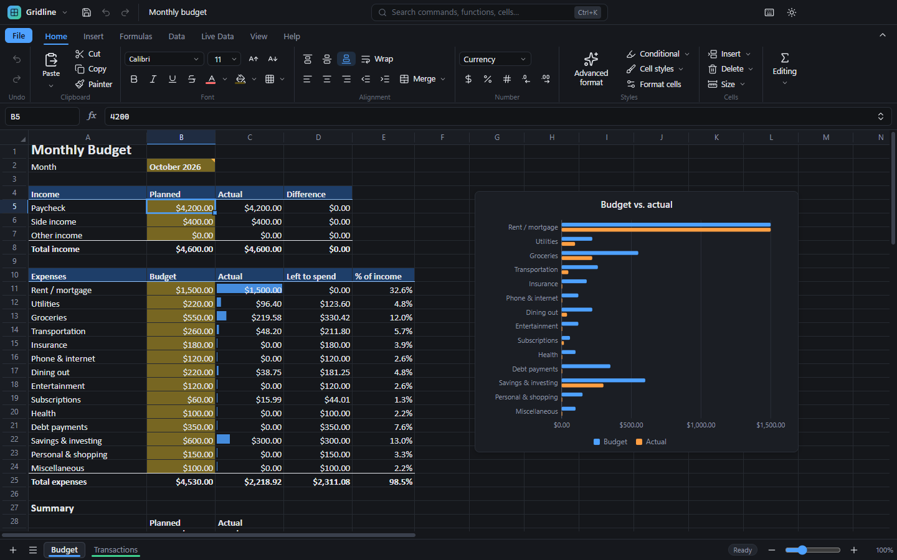
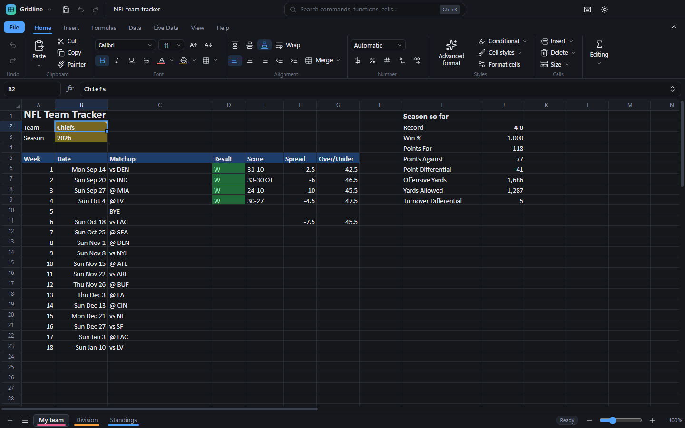

# Gridline

**A free, fast, dark-mode spreadsheet for Windows.** It opens and saves Excel (`.xlsx`) and CSV files, has 250+ formulas, and can pull live data into your sheets: stock and crypto prices, exchange rates, NFL stats, weather and more.

## Download and install

1. Go to the **[latest release](https://github.com/LucasHeh47/gridline/releases/latest)**.
2. Under **Assets**, download one of these files:

   | File | What it is |
   | --- | --- |
   | **`Gridline-Setup-x.y.z.exe`** | **The installer (recommended).** It adds Gridline to the Start menu and the desktop, opens `.xlsx` and `.csv` files with a double-click, and updates itself. |
   | `Gridline-Portable-x.y.z.exe` | A single file you can run from anywhere (for example a USB stick) without installing. It doesn't update itself; it tells you when a new version is available. |

3. Run the file you downloaded.

> **"Windows protected your PC"?** Gridline isn't signed with a paid code-signing certificate yet, so Windows SmartScreen may warn you the first time. Click **More info**, then **Run anyway**. You can confirm the file is genuine by downloading it only from this repository's Releases page.

**Requirements:** Windows 10 or 11 (64-bit). macOS and Linux builds aren't available yet.

## What it does

- **Opens and saves Excel and CSV files.** Formulas, formatting, merged cells, conditional formatting, charts, frozen panes and filters are kept.
- **250+ functions** (XLOOKUP, FILTER, SORT, UNIQUE, LET, SUMIFS, financial, date and text functions…) with dynamic arrays that spill into neighboring cells.
- **Errors in plain English.** A cell with an error explains what went wrong, points to the cell that caused it, and often offers a one-click fix.
- **A ribbon that stays out of the way.** Tabs with clearly labelled groups. Drag the ribbon's bottom edge to make it smaller, or press **Ctrl+K** to search every command.
- **Advanced format.** Select a table and Gridline formats it for you: header, dates, money, percentages, totals, column widths. You can keep it, try another style, or undo it in one click.
- **Live data:**
  - **Finance:** stock quotes and history, crypto prices, exchange rates.
  - **Sports:** NFL player and team stats, schedules, standings and leaders, back to 1999.
  - **World:** weather and forecasts, public holidays, country statistics.
- **10 ready-made presets.** Monthly budget, loan calculator, debt payoff, net worth, stock portfolio, crypto portfolio, NFL team tracker, fantasy football, trip planner and project tracker.
- **125 settings.** Theme, accent color, ribbon size, what Enter does, date format, AutoSave, CSV options and more.

## Learn more

- **[User guide](docs/user-guide.md)**: everything from the basics to live data, settings and shortcuts.
- **[Function reference](docs/functions.md)**: Gridline's own functions (live data and personal finance), with examples.
- **[What's new](CHANGELOG.md)**: changes in each version.

## Updates

The installed app checks for new versions when it starts and asks before installing anything. You can turn this off in **Settings → Updates**.

**Developer branch:** to try new features before they're released, turn on **Settings → Updates → Developer branch**. You'll get development builds, which are built automatically from the `develop` branch and may have bugs. Turn it off again to go back to regular releases at the next update.

## Privacy

- Gridline doesn't collect analytics or send your spreadsheets anywhere. There is no account to create.
- It only goes online in two cases:
  - **Live data.** When a formula asks for it, Gridline downloads that data and keeps a copy on your computer. Sources: [nflverse](https://github.com/nflverse) (NFL), Yahoo Finance (stocks), Coinbase (crypto), Frankfurter (exchange rates), Open-Meteo (weather), Nager.Date (holidays) and the World Bank (country data).
  - **Update checks** against this repository's GitHub Releases.
- You can turn live data off, or use only data you've already downloaded, in **Settings → Live data**.

## Building from source

See **[docs/development.md](docs/development.md)** for building, testing, the branch layout and how releases are published.

## License

[MIT](LICENSE)
