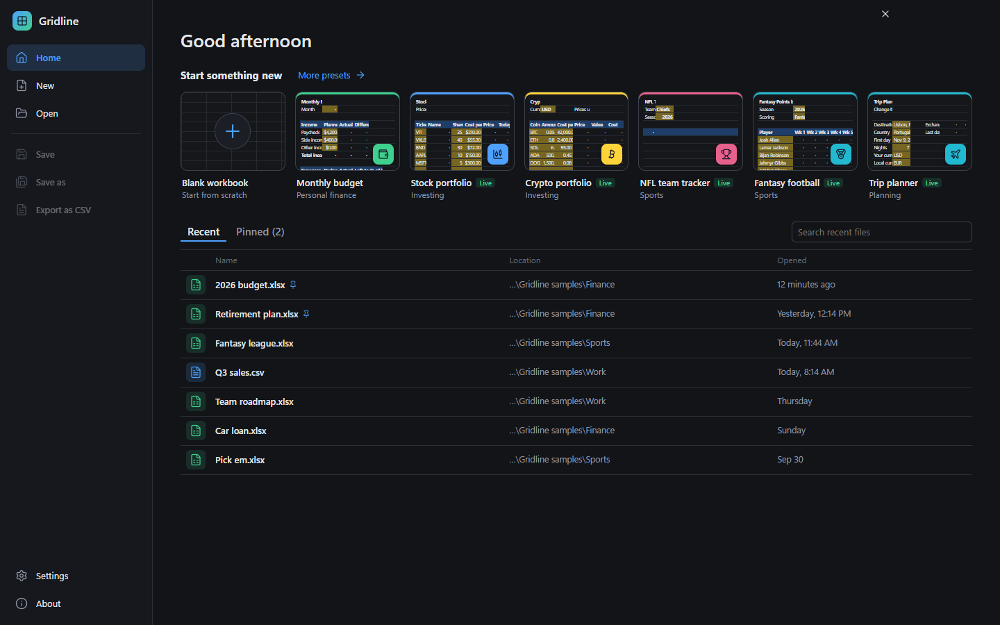
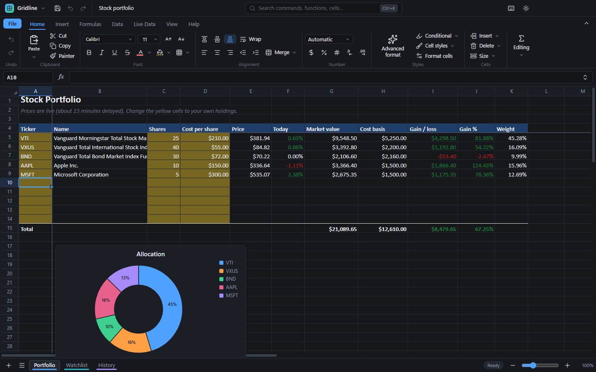

# Gridline user guide

1. [Install and update](#1-install-and-update)
2. [The Home page](#2-the-home-page)
3. [Finding your way around](#3-finding-your-way-around)
4. [Entering data and formulas](#4-entering-data-and-formulas)
5. [Formatting](#5-formatting)
6. [Sorting, filtering and organizing](#6-sorting-filtering-and-organizing)
7. [Charts](#7-charts)
8. [Live data](#8-live-data)
9. [Presets](#9-presets)
10. [Files, saving and Excel](#10-files-saving-and-excel)
11. [Macros and automation](#11-macros-and-automation)
12. [AI assistant (Beta)](#12-ai-assistant-beta)
13. [Settings](#13-settings)
14. [Keyboard shortcuts](#14-keyboard-shortcuts)
15. [Troubleshooting](#15-troubleshooting)

---

## 1. Install and update

1. Open the [latest release](https://github.com/LucasHeh47/gridline/releases/latest) and, under **Assets**, download **`Gridline-Setup-x.y.z.exe`**.
2. Run it.
   - Windows SmartScreen may say "Windows protected your PC" because the app isn't code-signed yet. Click **More info → Run anyway**.
   - The installer lets you choose the install folder and creates Start menu and desktop shortcuts.
3. Gridline opens `.xlsx`, `.csv` and `.tsv` files. To make it the default app for them, right-click a file → **Open with → Choose another app → Gridline → Always**.

**Portable version:** `Gridline-Portable-x.y.z.exe` runs without installing. It keeps its settings on the computer it runs on, and it can't update itself. When a new version is out, it offers to open the download page.

**Updates:**
- When Gridline starts, it checks GitHub for a newer version. If there is one, it shows what's new and asks before downloading.
- After the download, choose **Restart and update**, or let the update install the next time you close Gridline.
- You can check yourself any time: click the **Gridline** logo → **Check for updates**.

**Developer branch:**
- **Settings → Updates → Developer branch** gives you development builds as soon as they're made. They have the newest features first but may have bugs.
- Turning it off keeps your current version until the next regular release replaces it.

**Uninstall:** **Windows Settings → Apps → Installed apps → Gridline → Uninstall**.

## 2. The Home page

Home opens when Gridline starts. You can get back to it any time from the **File** tab or with **Ctrl+Shift+H**.

- **Start something new:**
  - **Blank workbook** starts from scratch.
  - Each card under it is a ready-made preset, and its thumbnail shows what you'll get.
  - **More presets** lists all of them, by category.
- **Recent:**
  - Files you've opened or saved recently. Click one to open it.
  - Hover a file to **pin** it (pinned files stay at the top) or use **⋯** to open it in a new window, show it in its folder, copy its path or remove it from the list.
  - The search box filters the list.
- **Open:** browse for any `.xlsx`, `.csv`, `.tsv` or `.txt` file. You can also drag a file onto the window.
- **Save, Save as, Export as CSV** and **Settings** are in the left column.

Press **Esc** or click **✕** to go back to your workbook. If the current window already has work in it, a new workbook or another file opens in a new window, so nothing gets replaced. You can change this in **Settings → Files & saving → Open files in**.

## 3. Finding your way around

### The title bar

- **Gridline logo menu:** Settings, Check for updates, What's new, Home, New window, Keyboard shortcuts and About.
- **Save, Undo and Redo buttons.**
- **The file name.** A dot after it means there are unsaved changes.
- **The search box (Ctrl+K):** type what you want to do ("freeze", "currency", "remove duplicates"), a cell address ("B12"), a sheet name, a function name, or text in your cells.

### The ribbon

| Tab | What's on it |
| --- | --- |
| **File** | Opens the Home page: new, presets, open, recent files, save, export. |
| **Home** | Undo; clipboard; font; alignment; number formats; **Advanced format**; conditional formatting and cell styles; insert/delete rows and columns; AutoSum, fill, clear, sort, filter and find. |
| **Insert** | Charts; functions; live data shortcuts; links and notes; rows and columns; new and duplicate sheets; presets. |
| **Formulas** | Insert function, AutoSum, and a menu for each function category; show formulas; trace precedents (the cells a formula uses); recalculate. |
| **Data** | Sort and filter; data validation and circling invalid data; remove duplicates; fill; Advanced format; refresh live data. |
| **Live Data** | **Finance** (stocks, price history, crypto, currencies), **Sports** (NFL data), **Weather & world** (weather, forecast, holidays, country data), and refreshing. |
| **Automate** | Run a macro; the macro editor; new macros; step macros (no code, Beta); buttons, shortcuts and automatic macros; macro settings. |
| **View** | Gridlines, headings, formula bar, status bar and the row-and-column highlight; zoom; freeze panes; light/dark theme and accent color; ribbon size; settings. |
| **Help** | Command search, keyboard shortcuts, function browser, what's new, updates, settings, about. |

**Resizing the ribbon:**
- Drag its **bottom edge** up or down to switch between three sizes:
  - **Full:** large buttons with labels.
  - **Compact:** one row of icons.
  - **Tabs only:** the ribbon pops up when you click a tab.
- You can also double-click a tab, press **Ctrl+F1**, or use the **⌃** button at the right end of the tabs.
- When the window is narrow, groups fold into a single button that opens them.

### The status bar

- When you select cells, the bottom right shows Sum, Average, Count, Min and Max. Click a total to copy it.
- The slider changes the zoom.
- A "Loading live data" message appears while downloads are running.

## 4. Entering data and formulas

- **Type and press Enter.** Enter moves down and Tab moves right. After Tab, Tab, Enter you land at the start of the next row.
  - **Shift+Enter** and **Shift+Tab** move back.
  - **Alt+Enter** adds a line break inside a cell.
  - **Ctrl+Enter** enters the same thing in every selected cell.
- **Numbers, dates and money are recognized as you type.** For example `$1,200`, `45%`, `3/14/2026` and `Mar 14`. Numbers with leading zeros (`00123`) and very long numbers (card or account numbers) stay exactly as typed. Start with `'` to force text.
- **Formulas start with `=`:**
  - As you type, Gridline suggests function names and shows what each argument means.
  - Inside quotes it suggests valid values, such as stat names, teams or currencies.
  - Click or drag on cells to insert references, and press **F4** to cycle `$` signs.
  - Each reference is colored in the formula and outlined on the sheet.
- **Missing parentheses or quotes are fixed for you** when you press Enter.
- **Errors explain themselves.** Select a cell with an error to see what went wrong, a button to jump to the cell that caused it, and often a one-click fix.
- **Fill:**
  - Drag the small square at the corner of the selection (the fill handle) to continue a pattern: 1, 2, 3…; Jan, Feb, Mar…; Week 1, Week 2…; dates.
  - Double-click the fill handle to fill down to the end of the neighboring data.
  - **Ctrl+D** fills down and **Ctrl+R** fills right.
- **Dynamic arrays:** formulas like `=SORT(A2:B20, 2, -1)` or `=UNIQUE(C2:C100)` spill into as many cells as they need. A dashed outline shows the spill range.

## 5. Formatting

- **Home → Font, Alignment and Number** cover the everyday options. The number format box shows a live preview of the selected cell in each format.
- **Format cells (Ctrl+1)** opens the full formatting panel: number formats, fonts, borders, fill and alignment.
- **Cell styles** apply ready-made looks: Title, Heading, Total, Good / Bad / Neutral, Input, Calculation, Note, Money, Percent.
- **Conditional formatting** colors cells by their values: highlight rules, top/bottom, above average, duplicates, color scales, data bars, icon sets and formulas.
- **Advanced format (Ctrl+Alt+F):**
  - Select a table, or just click a cell inside it. Gridline then:
    - works out the title, header row, totals row and what each column holds (dates, money, percentages, years, IDs, ZIP codes, phone numbers, yes/no, long text);
    - converts numbers stored as text;
    - styles the table, sizes the columns and freezes the header.
  - A card shows what it found:
    - **Keep** leaves it as it is.
    - **Try another style** cycles through four looks.
    - **Revert** puts everything back exactly as it was.
  - Its defaults (style, colors, currency symbol, date format, negative numbers and more) are in **Settings → Advanced format**.

## 6. Sorting, filtering and organizing

- **Sort A→Z / Z→A** sorts the table around the selected cell. **Custom sort** sorts by several columns.
- **Filter (Ctrl+Shift+L)** adds buttons to the header row. Pick values, or use conditions like "contains", "greater than", "top 10" or "above average".
- **Remove duplicates** keeps the first copy of each row.
- **Data validation** (**Data → Data validation**) limits what can be typed in cells:
  - Allow whole numbers, decimals, dates, times or text of a certain length (between 1 and 500, at least 0…), a **list of choices**, or a custom formula.
  - Lists show a dropdown arrow on the cell. Click it, or press **Alt+↓**, to pick a choice.
  - Add a **message** that appears when the cell is selected, and an **alert** for values that break the rule: *Stop* (not allowed), *Warning* (ask first) or *Information*.
  - **Circle invalid data** draws red circles around cells that already break their rule.
  - Rules work like Excel's and are kept in `.xlsx` files.
- **Freeze panes** keeps the top row, the first column, or everything above and left of the selected cell in view while you scroll.
- **Sheets:**
  - Use **+** at the bottom left to add a sheet.
  - Right-click a sheet tab to rename, duplicate, color, hide or delete it.
  - Drag tabs to reorder them.

## 7. Charts

1. Select data with labels, then **Insert → Quick chart (F11)** or pick a type: column, bar, line, area, pie, doughnut or scatter.
2. Click a chart to move or resize it. Its panel changes the type, titles, series, colors and legend.
3. Charts update when the data changes, and they're saved as real Excel charts in `.xlsx` files.

Chart colors, the default type, legend position and size are in **Settings → Charts**.

## 8. Live data

Live data functions bring outside data into cells and keep it current. You'll find them on the **Live Data** tab, and the full list with examples is in the [function reference](functions.md).

| Area | Functions | Source |
| --- | --- | --- |
| Stocks | `STOCK`, `STOCKHISTORY` | Yahoo Finance (about 15-minute delay) |
| Crypto | `CRYPTO` | Coinbase |
| Currencies | `FX`, `FXRATE` | European Central Bank, via Frankfurter |
| NFL | `NFL.PLAYER`, `NFL.TEAM`, `NFL.SCHEDULE`, `NFL.STANDINGS`… | nflverse, 1999 to today |
| Weather | `WEATHER`, `WEATHER.FORECAST` | Open-Meteo |
| Holidays | `HOLIDAYS` | Nager.Date |
| Countries | `COUNTRYDATA` | World Bank |

- **The NFL data panel** (**Live Data → NFL data**) builds tables for you:
  1. Pick player stats, team stats, a game log, a schedule, standings or league leaders.
  2. Choose the player or team, the seasons and the stats.
  3. Click **Insert**.
  - With **Cells I can drag**, you get a grid of simple formulas. Change the name in the first cell to switch players, or drag the last row down to add seasons.
- **While data downloads**, cells show **Loading…** and the status bar shows a spinner. Downloads are saved on your computer and reused, so live data keeps working offline.
- **Refresh all** (Ctrl+Alt+F5) downloads fresh data.
- **Settings → Live data:**
  - Refresh prices automatically every few minutes.
  - Choose your currency and weather units.
  - Turn on **Offline mode** to use only data you already have.
  - Turn live data off entirely.

## 9. Presets

| Preset | What's inside |
| --- | --- |
| **Monthly budget** | Planned vs. actual income and spending by category, with a chart. Log purchases on the Transactions sheet and they're totaled automatically. |
| **Loan & mortgage calculator** | Monthly payment, total interest, payoff date, money saved by extra payments, and a full payment schedule. |
| **Debt payoff planner** | Your debts and a monthly budget give a payoff plan, with avalanche, snowball and minimum-payments-only compared. |
| **Net worth & savings** | Assets and debts, emergency-fund months, a savings-goal calculator and a 30-year growth projection. |
| **Stock portfolio** *(live)* | Holdings with live prices, gains and allocation; a watchlist with 52-week ranges; a year of weekly price history. |
| **Crypto portfolio** *(live)* | Coins with live prices, value and gains in your currency, plus 7 days of prices. |
| **NFL team tracker** *(live)* | Your team's schedule and results, season stats, a division race comparison and league standings. |
| **Fantasy football** *(live)* | Weekly fantasy points for your roster, player comparisons and the top 10 at each position. |
| **Trip planner** *(live)* | A trip budget in any currency converted at live rates, the destination's 16-day forecast, and public holidays during your trip. |
| **Project tracker** | Tasks with owner, status, priority, dates and progress. Overdue work is highlighted and totals are kept for you. |

Yellow cells are the ones meant for you to change. Your favorite NFL team, fantasy scoring and currency (set in Settings) are used when you create a preset.

## 10. Files, saving and Excel

- **Save (Ctrl+S)** keeps the file's current format. **Save as (Ctrl+Shift+S)** can save as `.xlsx`, `.xlsm` (with macros) or `.csv`.
- **CSV files** hold one sheet of values only. If your workbook has formatting, formulas or several sheets, Gridline asks whether to keep the CSV or save an `.xlsx` copy.
- **AutoSave** (**Settings → Files & saving**) saves `.xlsx` files that already have a location every few minutes.
- **Excel compatibility:**
  - Gridline keeps formulas, formatting, merged cells, conditional formatting, data validation, charts, freeze panes, filters, notes and links.
  - Calculations match Excel exactly, down to the last digit. Gridline adds, rounds and displays numbers the same way Excel does.
  - Macro-enabled `.xlsm` files open with their VBA code, and the code is saved back. See [Macros and automation](#11-macros-and-automation).
  - Old `.xls` files need to be saved as `.xlsx` in another app first.
- **Gridline-only functions** (live data and personal finance) are saved with their last results, so the values still show in Excel. Excel can't recalculate them.

## 11. Macros and automation

A macro repeats work for you, like cleaning up a table, coloring rows or adding a dated entry to a log.
The full guide is in **[Macros in Gridline](macros.md)**.

- **Automate → Run macro** (or **Alt+F8**) runs a macro. **Esc** stops one that's running, and **Ctrl+Z** undoes a whole run.
- **Automate → Macro editor** (or **Alt+F11**) opens the editor under the grid. Write VBA like in Excel and press **F5** to run it.
- **Step macros (Beta):** build a macro from plain-English steps instead of code. Available with the Developer branch.
- **Buttons, shortcuts and automatic macros:** run a macro from a button on the sheet, a key combination, or when the file opens or cells change.
- **Safety:** macros in files you open stay off until you click **Enable macros**, and they can only work with the workbook.

## 12. AI assistant (Beta)

Ask questions about the workbook, or ask for changes in plain English: "find duplicate transactions, but don't delete anything" or "add a formula that categorizes these transactions". The full guide is in **[AI assistant](ai-assistant.md)**.

- **Home → Ask AI** (or **Ctrl+Shift+A**) opens the assistant. It's available on the Developer branch in the desktop app.
- It uses Claude with your own API key, or a model on your computer (Ollama or LM Studio).
- It reads whatever it needs, across sheets, formulas and charts. Every read is listed in the chat.
- Changes go straight into the sheet so you can see them, with a card listing every cell before → after (plus results elsewhere that change), a one-click **Undo**, and **Advanced format** to style the new cells. To approve each change first instead, turn on **Ask before changing the workbook** in Settings → AI assistant.

## 13. Settings

Open **Settings** from the Gridline logo, from **Help → Settings**, or with **Ctrl+,**. Changes apply immediately.

| Section | Examples |
| --- | --- |
| Appearance | Dark / light / match Windows; accent color; contrast; density; interface font and size; which bars are shown; tooltips |
| Ribbon | Size, labels, icon size, which tabs are shown, starting tab |
| Grid & sheets | Gridline color, headings, row/column highlight, negative numbers in red, hide zeros, fill handle, scroll speed, defaults for new workbooks |
| Editing | Where Enter moves, date order (month/day or day/month), leading zeros, automatic decimal point, autocomplete, undo steps |
| Formulas & errors | Error explanations, quick fixes, formula bar font and size, updating NOW()/TODAY() on a timer |
| Advanced format | First style, header color, currency symbol, date format, negative numbers, decimals, freeze and filter |
| Files & saving | Startup (Home, blank workbook, or last file), where files open, recent file count, AutoSave, CSV separator, encoding, dates |
| Live data | On/off, offline mode, price refresh, your currency, weather units, NFL refresh interval, downloaded data |
| AI assistant | Claude or a local model, which Claude model, API key, local server and model, cells per read (Developer branch) |
| Macros | Whether to ask before running macros in files, automatic macros, trusted files |
| Sports | Favorite NFL team, fantasy scoring, defaults for the NFL data panel |
| Charts | Color palette, gridlines, pie percentages, default type, legend and size |
| Status bar | Which totals are shown, click-to-copy, zoom slider |
| Keyboard & search | What command search includes |
| Updates | Version, check now, automatic checks, background downloads, **Developer branch** |

- Use the search box at the top to find any setting.
- Changed settings show a **↺** button that resets them.
- **Export… / Import…** move your settings to another computer, and **Reset all** goes back to the defaults.

## 14. Keyboard shortcuts

Every command can also be found with **Ctrl+K**. **Ctrl+/** shows this list inside the app.

| Action | Keys |
| --- | --- |
| Search commands, cells, sheets and functions | Ctrl+K |
| Home page | Ctrl+Shift+H |
| New workbook / new window | Ctrl+N / Ctrl+Shift+N |
| Open / Save / Save as | Ctrl+O / Ctrl+S / Ctrl+Shift+S |
| Settings | Ctrl+, |
| Ask AI (Developer branch) | Ctrl+Shift+A |
| Undo / Redo | Ctrl+Z / Ctrl+Y |
| Cut / Copy / Paste / Paste values | Ctrl+X / Ctrl+C / Ctrl+V / Ctrl+Shift+V |
| Edit the cell | F2 (or double-click) |
| Fill down / right | Ctrl+D / Ctrl+R |
| Find / Replace / Go to | Ctrl+F / Ctrl+H / Ctrl+G |
| Bold / Italic / Underline | Ctrl+B / Ctrl+I / Ctrl+U |
| Format cells | Ctrl+1 |
| Advanced format | Ctrl+Alt+F |
| Currency / Percent / Date format | Ctrl+Shift+4 / Ctrl+Shift+5 / Ctrl+Shift+3 |
| AutoSum | Alt+= |
| Insert function | Shift+F3 |
| Quick chart | F11 |
| Filter on/off | Ctrl+Shift+L |
| Insert rows / delete rows | Ctrl+Shift+= / Ctrl+- |
| Today's date / current time | Ctrl+; / Ctrl+Shift+; |
| Show formulas | Ctrl+` |
| Recalculate / refresh live data | F9 / Ctrl+Alt+F5 |
| Zoom in / out / 100% | Ctrl+Alt+= / Ctrl+Alt+- / Ctrl+0 (or Ctrl+mouse wheel) |
| Ribbon tabs only | Ctrl+F1 |
| New sheet / next / previous sheet | Shift+F11 / Ctrl+PageDown / Ctrl+PageUp |
| Macro editor / run a macro | Alt+F11 / Alt+F8 |
| Run the macro in the editor / stop a macro | F5 / Esc |

## 15. Troubleshooting

**A cell says Loading… for a long time.**
- The data is still downloading, or the connection is slow. The status bar shows how many downloads are running.
- If it never finishes, check your internet connection and use **Live Data → Refresh all**.

**`#CONNECT!`**
- The data couldn't be downloaded. Possible causes:
  - you're offline;
  - **Offline mode** is on and that data was never downloaded;
  - live data is turned off in **Settings → Live data**.

**`#N/A` from a live data function.** The data doesn't exist. For example:
- a game that hasn't been played yet, or a bye week;
- a player with no stats that season;
- a misspelled ticker or place.

The error card explains which.

**`#NAME?` in Excel.** The file uses Gridline-only functions, which Excel doesn't have. Open it in Gridline to update those values.

**Windows warns about the installer.** See [Install and update](#1-install-and-update). Gridline isn't code-signed yet.

**Reset everything.** Go to **Settings → Reset all**. Your settings are stored on your computer, not in your files, so resetting doesn't change any spreadsheet.

**Report a problem or suggest a feature.** Open an issue at <https://github.com/LucasHeh47/gridline/issues>.
